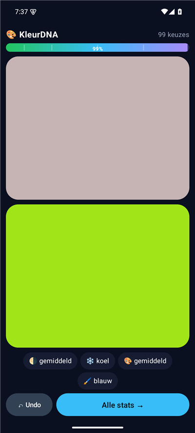
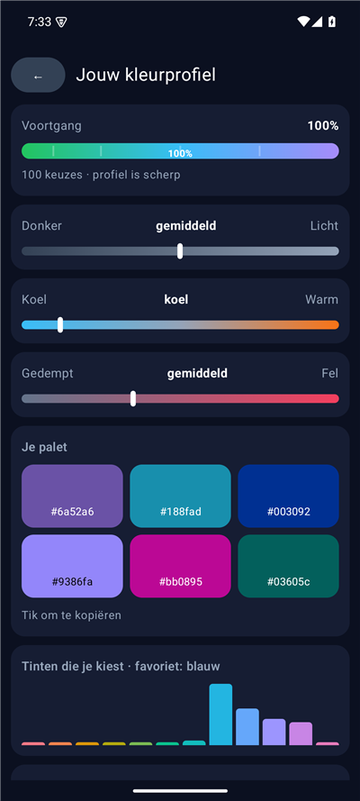

# 🎨 KleurDNA

Een kleine Android-app die ontdekt welke kleuren jij mooi vindt. Je kiest steeds tussen twee kleuren; na ongeveer 100 keuzes heb je een scherp kleurprofiel en een eigen palet.

Deze repo bevat de **builds**. De broncode staat in [KleurDNA-source](https://github.com/ericbruggema/KleurDNA-source).

 

## Installeren

1. Download `KleurDNA.apk` bij de [Releases](../../releases/latest).
2. Open het bestand op je telefoon en sta installeren uit onbekende bronnen toe als Android daarom vraagt.

Vereist Android 8.0 of nieuwer. Alles blijft op je telefoon: geen internet, geen accounts.

> De APK is getekend met de standaard debug-sleutel van Android. Een update over een eerdere installatie heen werkt alleen als de APK met dezelfde sleutel is gemaakt.

## Nieuwe build uploaden

De APK komt uit de GitHub Actions-build van de bronrepo (de bijlage bij de release daar, of het artifact van een run). Upload hem hier als release:

```bash
gh release create v1.1 KleurDNA.apk --title "KleurDNA v1.1" --notes "Wijzigingen..."
```
